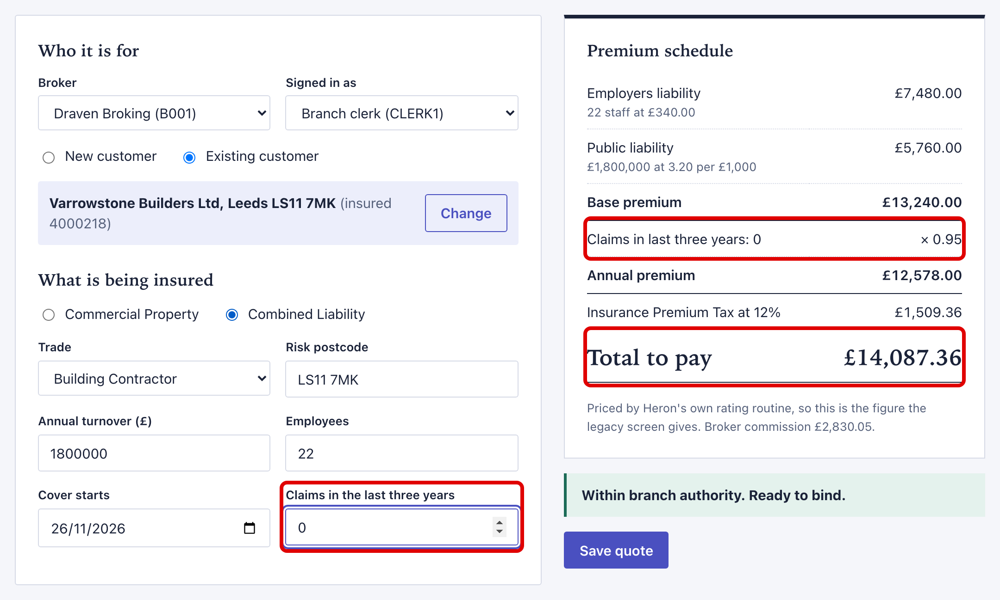
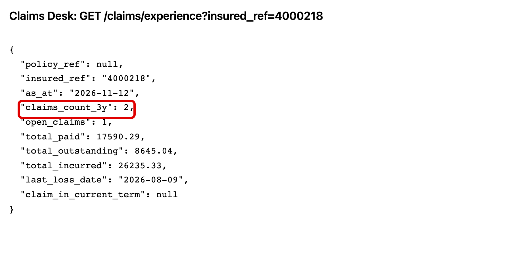
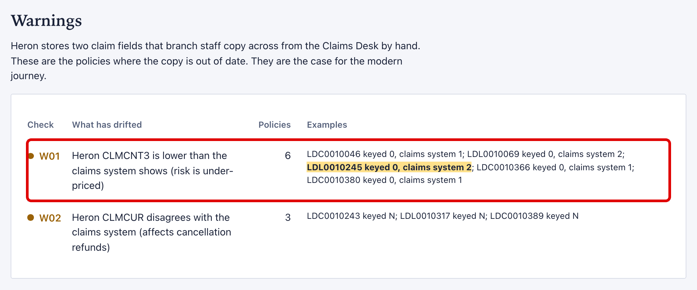
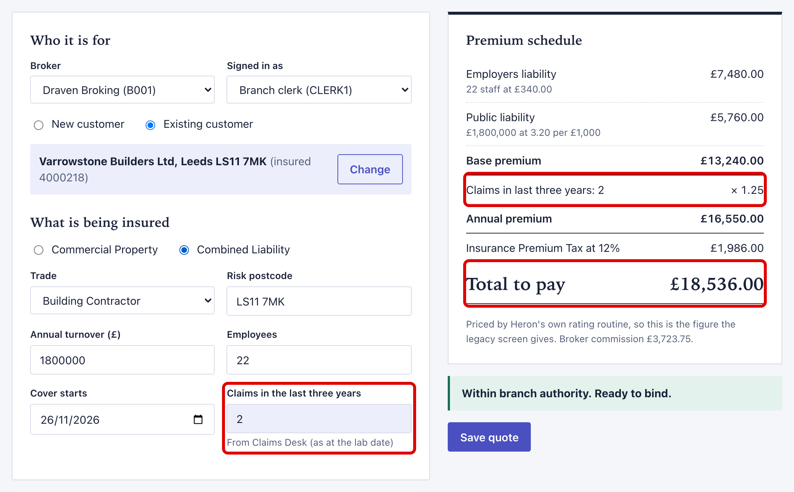
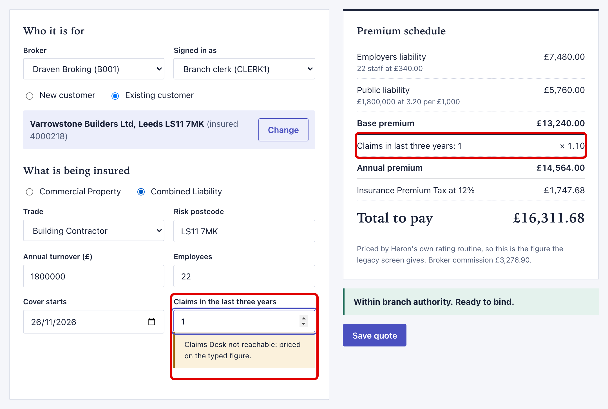

# Card 1: claim count from the claims system

**Size:** small, suits block 1. **Connects to:** Claims Desk.

## Today
On the new quote screen the user types "claims in the last three years" by hand, usually from a screen in the Claims Desk. Heron prices on whatever was typed. The Data health page shows policies where the typed figure is already out of date.

*Varrowstone Builders is an existing customer. The clerk types 0 claims, and Heron prices on 0: a ×0.95 discount and £14,087.36 to pay.*

*The Claims Desk knows Varrowstone has had 2 claims in the last three years. Nothing carries that figure into the quote.*

*Data health already flags it: Varrowstone's policy LDL0010245 has 0 keyed in Heron, but the Claims Desk has 2. The risk is under-priced.*

## The change
When the quote is for an existing customer, the price uses the Claims Desk's count instead of the typed one, and the screen shows that figure as read-only with where it came from. New customers still type it.

*Same quote after the change. The field is read-only, shows 2 "From Claims Desk", and Heron prices on 2: ×1.25 and £18,536.00 to pay.*

*If the Claims Desk doesn't answer, the quote still prices on the typed figure (1 here), and the screen says so.*

## Where to look
- `server/modern/api.py`: `price_quote` and `create_quote`
- Claims Desk: `GET /api/systems/claims/experience?insured_ref=` returns `claims_count_3y`
- `client/src/views/QuoteJourney.vue`: the claims field
- `docs/ARCHITECTURE.md`: call other systems over HTTP, and keep going if one is down

## Done when
- Pricing an existing customer uses the Claims Desk count, whatever was typed, and the premium schedule shows it.
- If the Claims Desk is not answering, pricing still works from the typed figure.
- New tests prove both, and every existing test still passes.

Try it on **Varrowstone Builders**, whose Heron record shows fewer claims than the Claims Desk.

## A good spec will ask
Which count is right when they disagree, and should the user be able to override it? Who owns that decision?

## Out of scope
Renewals, and writing the count back into Heron.
