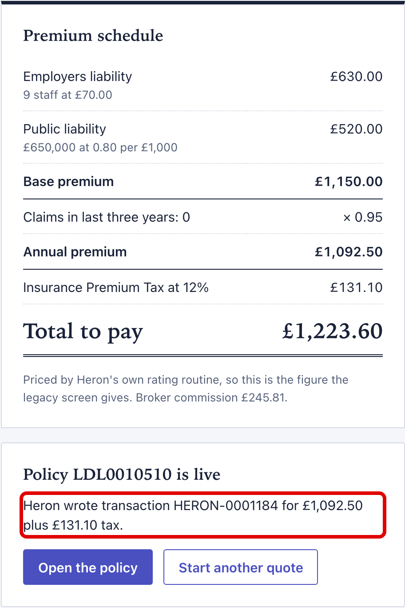
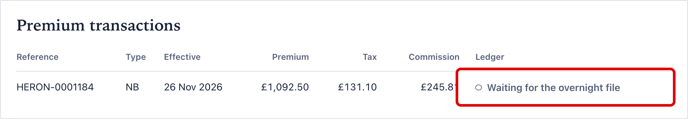
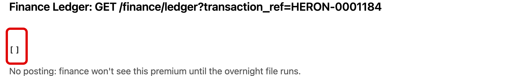
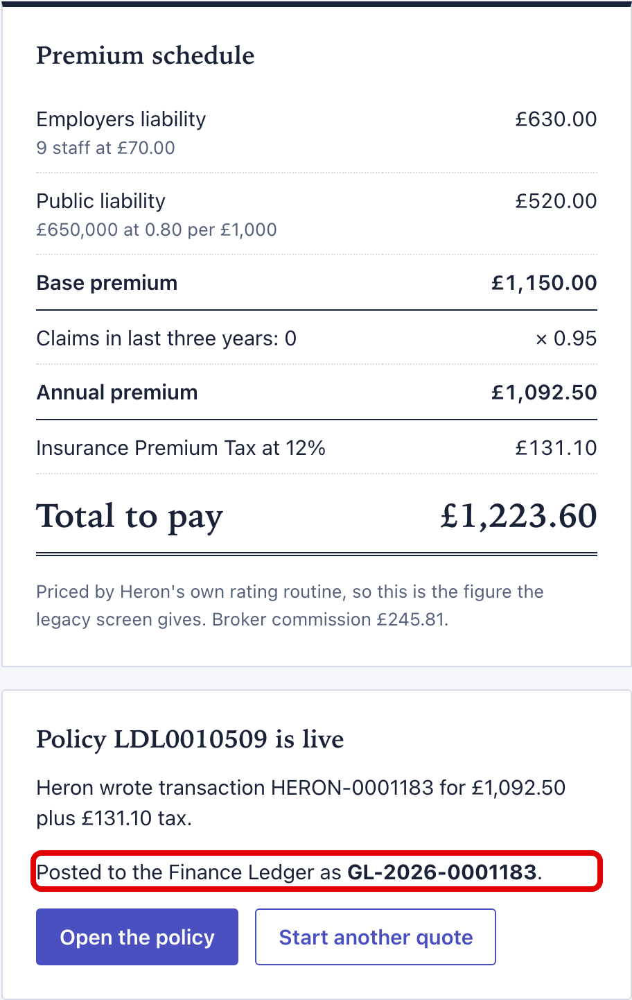
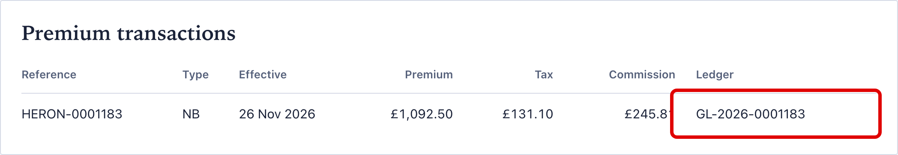
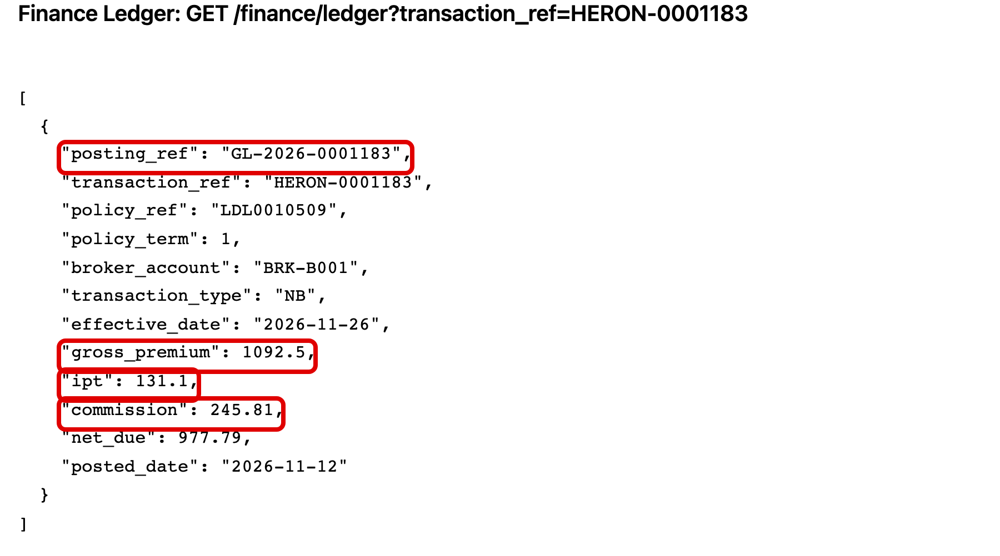
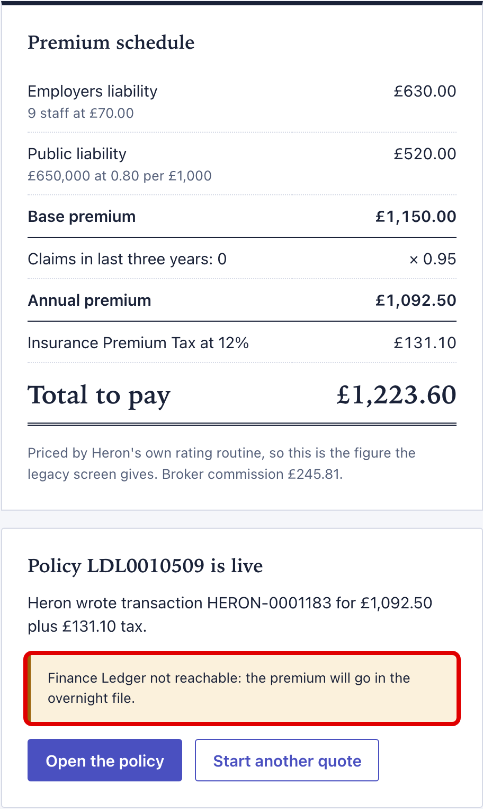

# Card 2: premium to finance at bind

**Size:** small, suits block 1. **Connects to:** Finance Ledger.

## Today
When a policy is bound, Heron writes the premium transaction and finance receives it in the overnight file. Until then the policy page shows "Waiting for the overnight file".

*The clerk binds a new policy. Heron writes the premium transaction, and that's where it stops: nothing goes to finance.*

*On the policy page, the Ledger column says "Waiting for the overnight file".*

*Ask the Finance Ledger for that transaction and it has nothing. Finance won't see the premium until tomorrow.*

## The change
Binding a policy posts the premium to the Finance Ledger straight away, and the policy page shows the ledger reference.

*After the change, binding posts the premium straight away, and the panel shows the ledger reference.*

*The policy page's Ledger column shows the reference instead of "Waiting for the overnight file".*

*The ledger now holds one posting, with the same premium (£1,092.50), tax (£131.10) and commission (£245.81) as Heron's transaction.*

*If the Finance Ledger doesn't answer, the bind still succeeds and the screen says the premium will go in the overnight file.*

## Where to look
- `server/modern/api.py`: `bind_quote`
- `server/modern/adapter.py`: the transaction comes back from Heron as `transaction_ref`, `gross_premium`, `ipt`, `commission`
- Finance Ledger: `POST /api/systems/finance/postings`, idempotent on `transaction_ref`
- `client/src/views/QuoteJourney.vue`: the "Policy is live" panel

## Done when
- A bound policy has a posting in the ledger with the same premium, tax and commission as Heron's transaction.
- Posting the same transaction twice does not double count.
- If the Finance Ledger is not answering, binding still succeeds and the screen says the premium will go in the overnight file.
- New tests prove all three, and every existing test still passes.

## A good spec will ask
What happens to the overnight file once postings go in real time: does it skip transactions that already have a ledger reference? Who in finance signs that off?

## Out of scope
Mid-term adjustments and cancellations, which post the same way and make a good second change.
