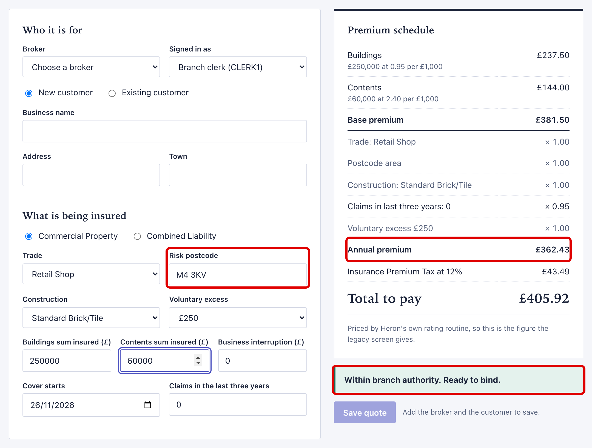
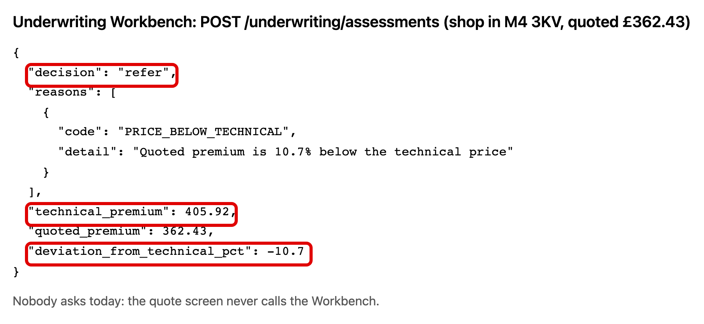
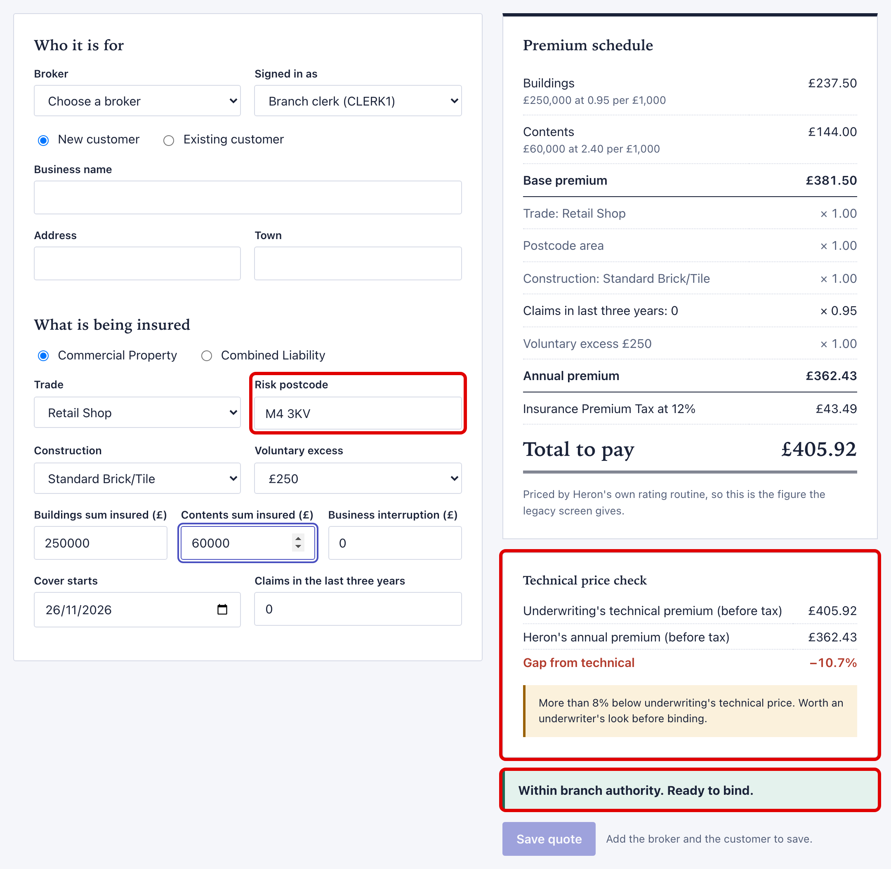
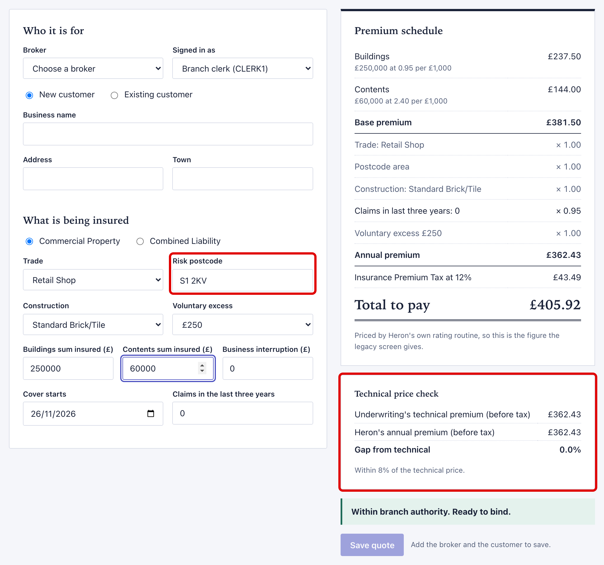
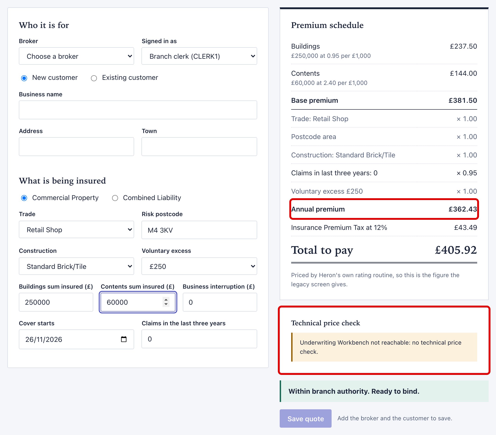

# Card 3: technical price check

**Size:** medium, suits block 2. **Connects to:** Underwriting Workbench.

## Today
Nobody compares the price Heron quotes with underwriting's technical price. Underwriting only sees a risk if it is referred and re-keyed.

*A shop in Manchester (M4 3KV) is quoted at £362.43 a year, and the screen says it's ready to bind. Nothing on screen compares it with underwriting's price.*

*Underwriting's Workbench would price the same shop at £405.92. The quote is 10.7% below technical, and the Workbench would refer it. Nobody asks.*

## The change
While quoting, the screen shows underwriting's technical price and how far the quoted premium is from it, and flags a quote more than 8% below technical.

*After the change, the quote shows the technical price beside Heron's and warns when it's more than 8% below. The warning is advice only: Heron's price and decision are unchanged.*

*The same shop in Sheffield (S1 2KV) matches the technical price exactly. Only single-letter postcode areas like M are out (see `docs/DOMAIN.md`, item 1).*

*If the Workbench doesn't answer, the quote still prices and the panel says there's no technical price check.*

## Where to look
- `server/modern/api.py`: `price_quote`
- Underwriting Workbench: `POST /api/systems/underwriting/assessments` with the risk and `quoted_premium`, returns `technical_premium` and `deviation_from_technical_pct`
- `client/src/views/QuoteJourney.vue`: the right-hand column under the premium schedule

## Done when
- Every priced quote shows the technical price and the gap, with a warning past 8% below.
- If the Workbench is not answering, the quote still prices and the panel says so.
- Heron's price is unchanged: the characterisation tests still pass.
- New tests prove the above.

Try it on a shop in **M4 3KV** (Manchester), then the same shop in **S1 2KV** (Sheffield).

## A good spec will catch
Manchester quotes come out about 11% below technical and Sheffield ones do not. The cause is a known Heron behaviour (`docs/DOMAIN.md`, item 1). The fix is a pricing decision, so the spec should record it for underwriting sign-off and leave Heron alone.

## Out of scope
Changing any price, and raising referrals automatically.
