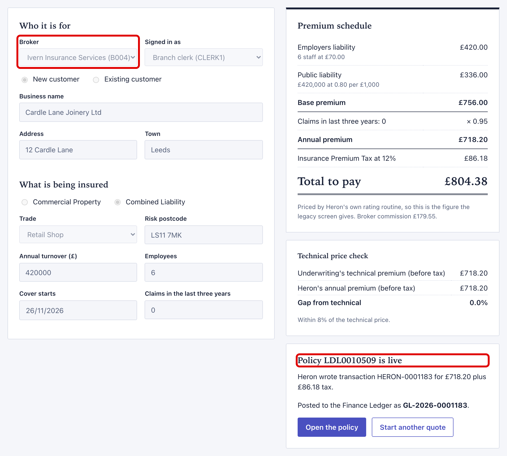
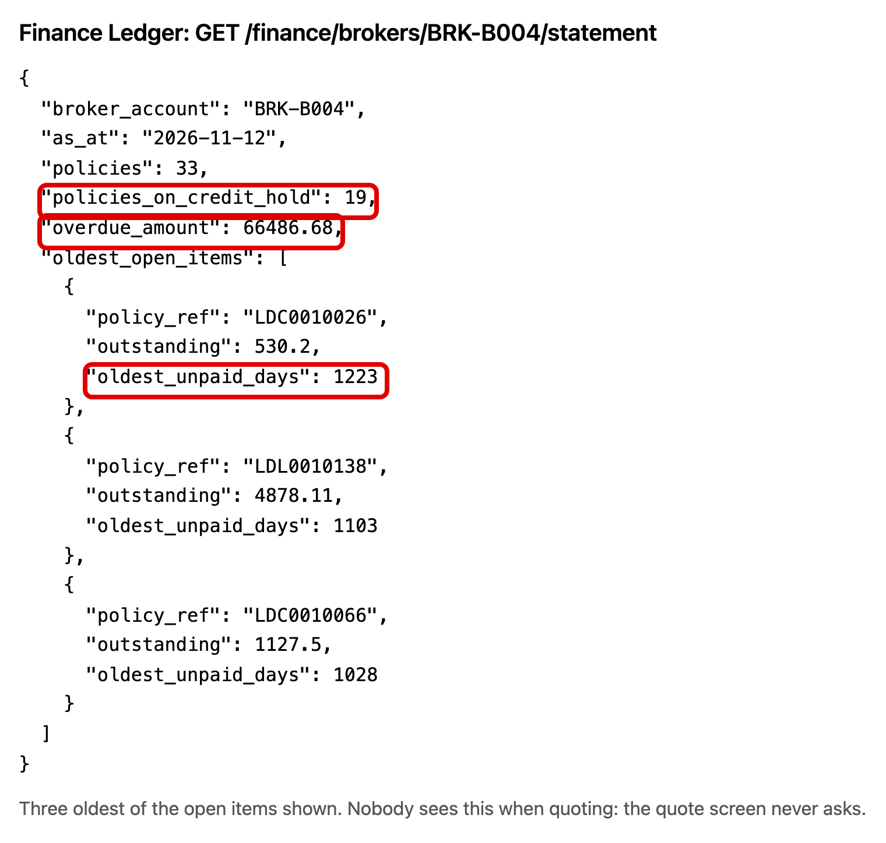
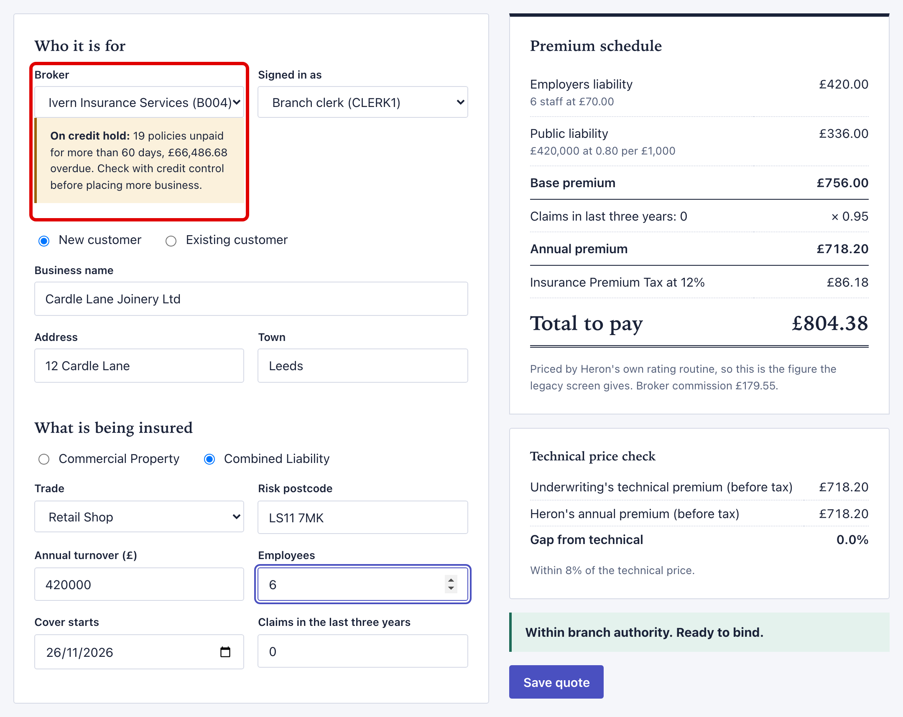
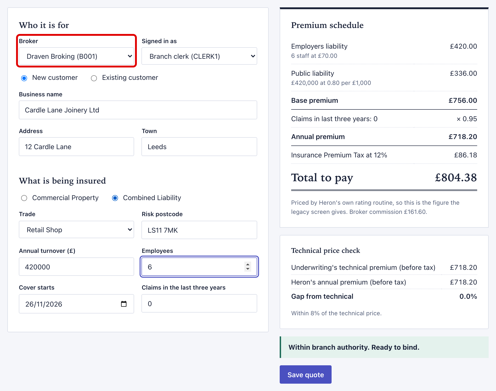
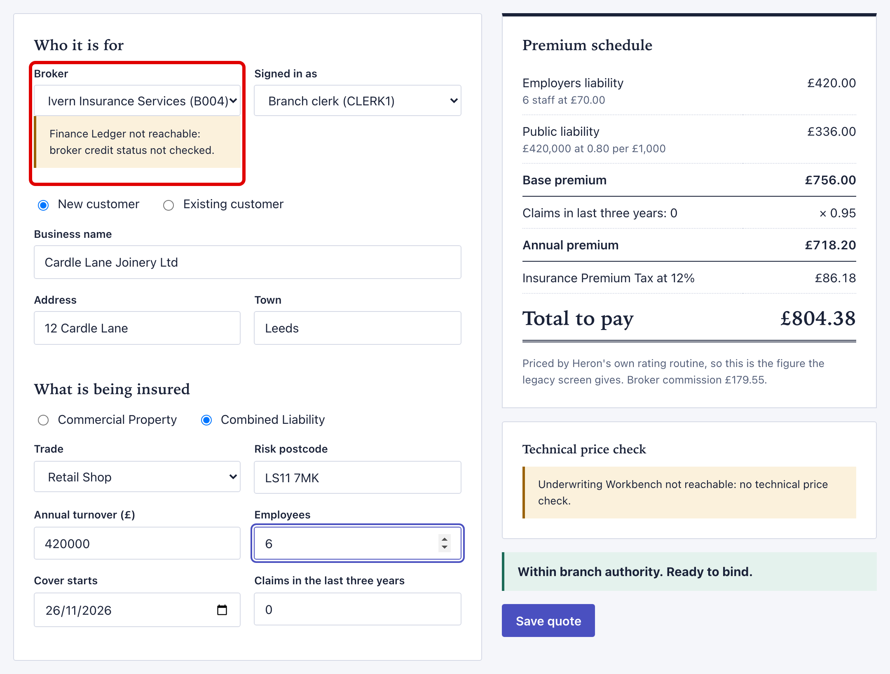

# Card 4: credit hold warning

**Size:** medium, suits block 2. **Connects to:** Finance Ledger.

## Today
A quote can be saved and bound for a broker who has owed premium for months. Credit control only finds out later.

*The clerk quotes, saves and binds through Ivern Insurance Services (B004). Nothing on screen says anything about the broker's account.*

*The Finance Ledger knows B004 has 19 policies on credit hold and £66,486.68 overdue, the oldest unpaid for 1,223 days. Credit control only finds out later.*

## The change
When a broker is chosen on the quote screen, the screen warns if that broker has any policy on credit hold (premium unpaid for more than 60 days), with the amount overdue, before the quote is saved.

*After the change, choosing B004 shows the credit hold warning and the amount overdue before the quote is saved. It's a warning only: Save quote still works.*

*A broker in good standing, such as Draven Broking (B001), shows nothing.*

*If the Finance Ledger doesn't answer, quoting still works and the screen says the credit status wasn't checked. Here every downstream system is down, so the technical price check says so too.*

## Where to look
- `server/modern/api.py`: `price_quote` receives `broker_code`
- Finance Ledger: `GET /api/systems/finance/brokers/BRK-{code}/statement` returns `policies_on_credit_hold` and `overdue_amount`
- `client/src/views/QuoteJourney.vue`

## Done when
- Choosing a broker with overdue premium shows the warning and the amount; a broker in good standing shows nothing.
- If the Finance Ledger is not answering, quoting still works.
- New tests prove both, and every existing test still passes.

Try broker **B004**, who placed Ombrelfield Storage and pays late. Most brokers, such as **B001**, are in good standing.

## A good spec will ask
Warn or block? Blocking a broker is a credit control decision, so who signs it off?

## Out of scope
Blocking the bind, and chasing payment.
