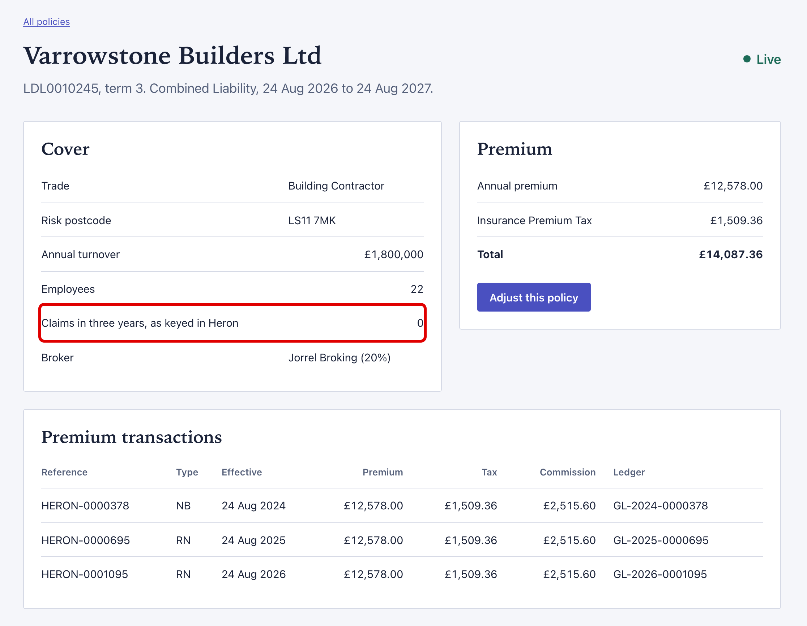
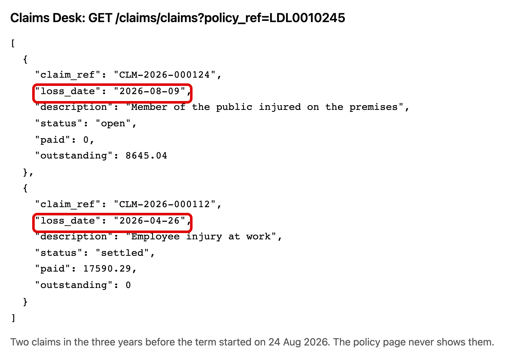
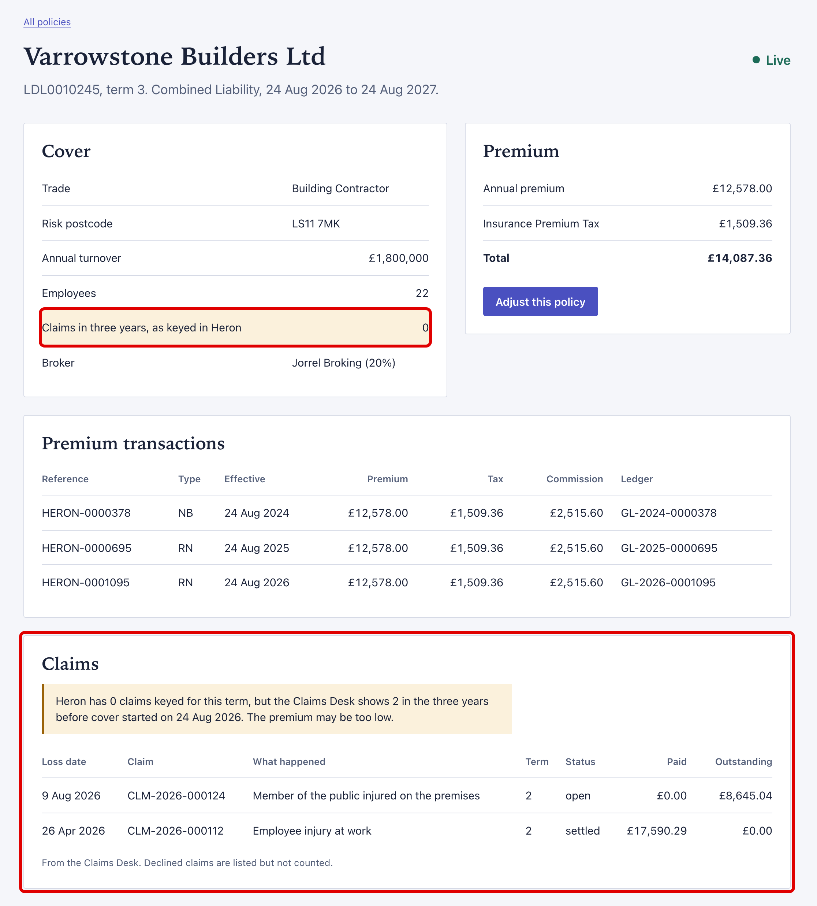
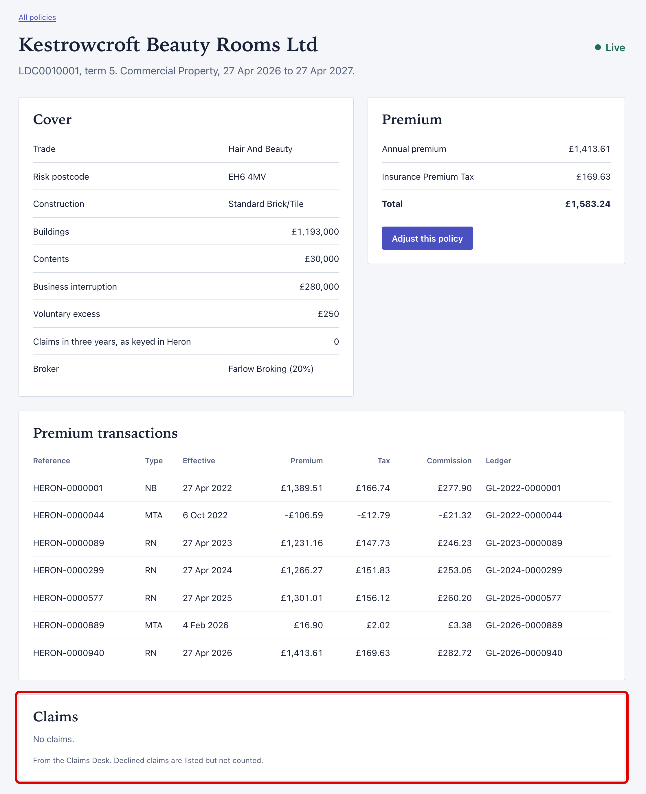
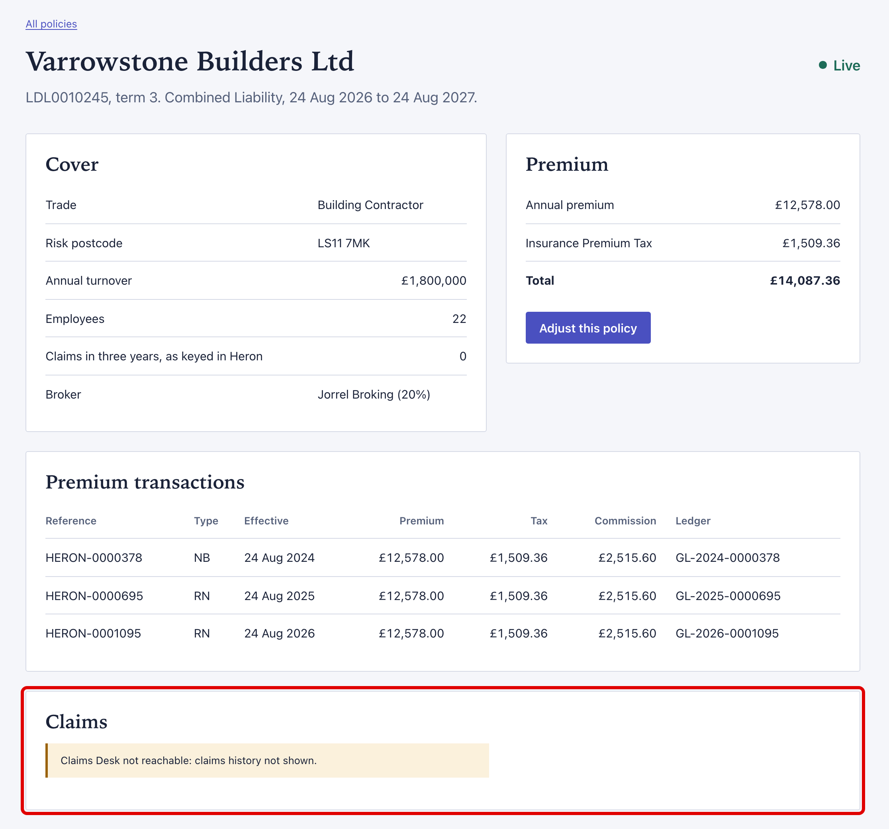

# Card 5: claims history on the policy

**Size:** medium, suits block 2. **Connects to:** Claims Desk.

## Today
The policy page shows only the claim count someone typed into Heron. To see the claims, staff open the Claims Desk separately.

*Varrowstone Builders' policy page shows 0 claims, as typed into Heron when the term started on 24 Aug 2026. There are no claims on the page.*

*The Claims Desk has 2 claims on this policy, both in the three years before the term started. Staff have to open the Claims Desk separately to see them.*

## The change
The policy page lists the policy's claims from the Claims Desk (loss date, what happened, status, paid and outstanding), and flags when Heron's typed claim count is lower than the Claims Desk shows.

*After the change, the policy page lists the claims and flags that Heron has 0 keyed while the Claims Desk shows 2 before cover started. The keyed row is highlighted. Heron's figure isn't changed.*

*A policy with no claims says so, and there's no flag.*

*If the Claims Desk doesn't answer, the policy page still loads and the Claims section says so.*

## Where to look
- `server/modern/api.py`: `get_policy`
- Claims Desk: `GET /api/systems/claims/claims?policy_ref=` and `GET /api/systems/claims/experience?policy_ref=&as_at=`
- `client/src/views/Policy.vue`

## Done when
- The claims list appears on the policy page, and the flag shows where the counts differ.
- If the Claims Desk is not answering, the policy page still loads.
- New tests prove both, and every existing test still passes.

Try **Varrowstone Builders**.

## A good spec will ask
Compare at which date? Heron priced the term on the count at inception, so the fair comparison is the claims in the three years before the term started.

## Out of scope
Changing Heron's figure.
